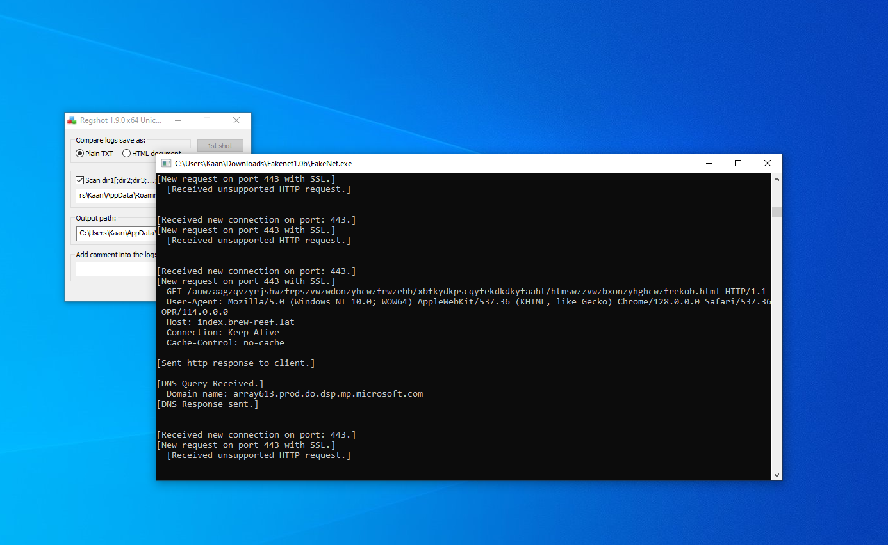
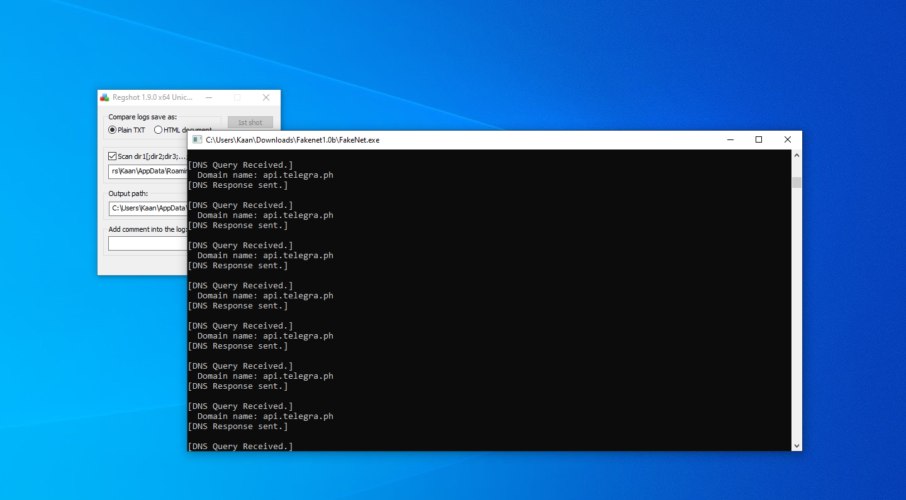
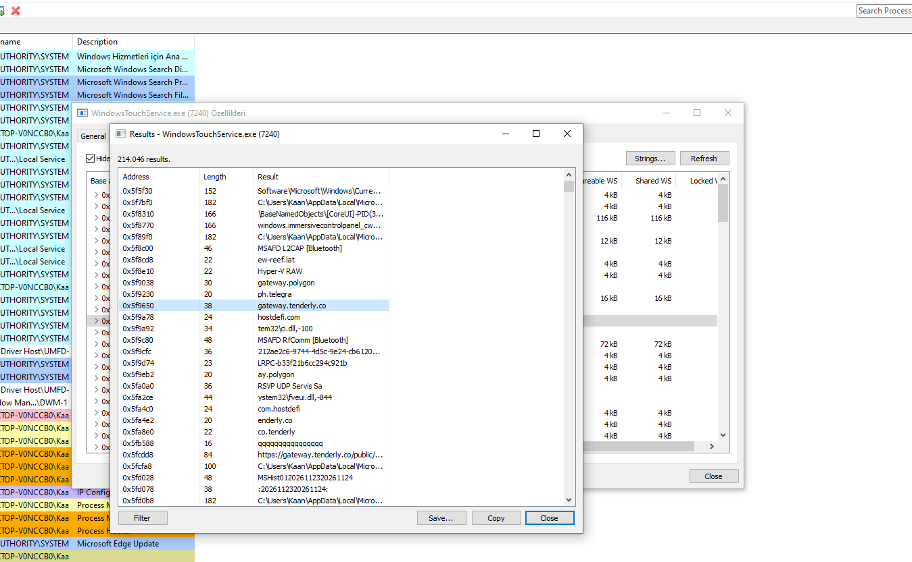
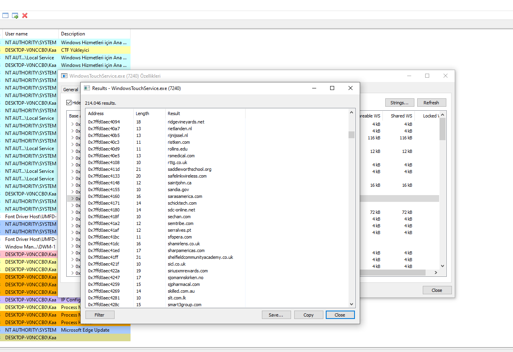
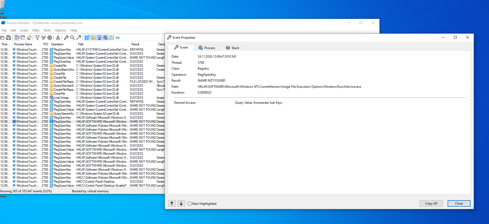
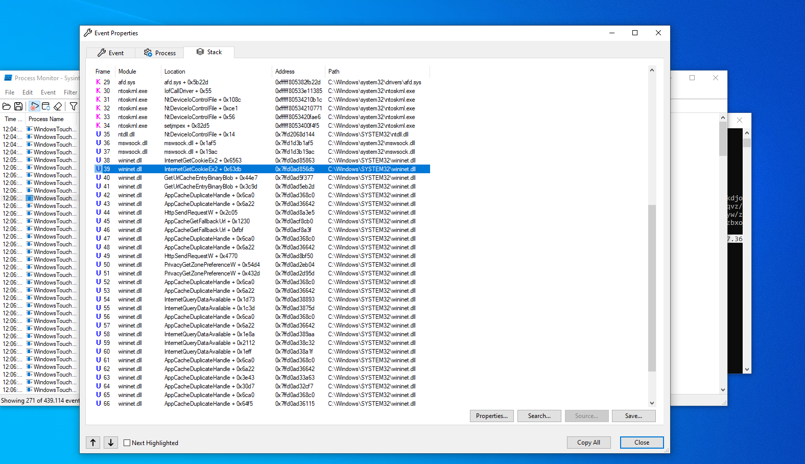

## 1. Rev Stealer – Initial C2 Communication & Secondary Payload Request

Dynamic network analysis of the Rev Stealer sample using FakeNet-NG captures an immediate outbound HTTPS connection upon execution. The intercepted SSL traffic on port 443 reveals the active C2 domain (index.brew-reef.lat), a spoofed browser User-Agent string, and a long randomized URI path ending in .html. This indicates the stealer checks in with its C2 infrastructure and likely attempts to fetch a staged secondary payload or configuration disguised as a web page.

### Key Observations:

**C2 Host & Protocol**: Host: index.brew-reef.lat over HTTPS (port 443 with SSL) captured in FakeNet-NG.
**Payload / Staging URL**: 
GET /auwzaagzqvzyrjshwzfrpszwvzwdonzyhcwzfrwzebb/xbfkydkpscqyfekdkdkyfaaht/htmswzzvwzbxonzyhghcwzfrekob.html HTTP/1.1 – long randomized path ending in .html, typical for staged payload delivery or C2 routing.
**Browser Masquerading (User-Agent)**:
Mozilla/5.0 (Windows NT 10.0; WOW64) AppleWebKit/537.36 (KHTML, like Gecko) Chrome/128.0.0.0 Safari/537.36 OPR/114.0.0.0 – spoofs a legitimate Chrome/Opera browser header to blend in with normal web traffic.
**Connection Headers**: Connection: Keep-Alive and Cache-Control: no-cache ensure fresh responses from the C2 server

### Why This Matters:

**Immediate C2 Beaconing**: Contacting index.brew-reef.lat right after execution confirms active command-and-control communication.
**Staged Payload Delivery**: Requesting a randomized .html path points to retrieving a next-stage payload or encoded commands.
**Traffic Blending**: Spoofing a standard Chrome/Opera User-Agent helps bypass basic network anomaly and user-agent filters.
**Network IoCs**: Both index.brew-reef.lat and the randomized URI pattern serve as high-confidence network indicators for blocking and detection

### Visual Reference:

## 2. Rev Stealer – Repeated Telegram API DNS Requests

Dynamic network monitoring of the Rev Stealer sample in FakeNet-NG shows repeated outbound DNS queries targeting api.telegra.ph. The captured log entries indicate ongoing resolution attempts toward Telegram-related API infrastructure during execution.

### Key Observations:

**Repeated DNS Queries**: FakeNet-NG logs multiple [DNS Query Received.] and [DNS Response sent.] cycles for api.telegra.ph.
**Exfiltration / API Channel**: Queries to api.telegra.ph suggest attempted use of Telegram-associated API endpoints for messaging or data transfer.
**Persistent Polling Behavior**: Repeated lookups show continuous or retry-driven communication attempts during runtime.

### Why This Matters:

**Messaging API Abuse**: Malware frequently uses legitimate messaging APIs to blend exfiltration or bot traffic with normal traffic.
**Repeated Lookup Pattern**: Frequent DNS queries to api.telegra.ph provide a clear behavioral signal in network logs.
**Exfiltration Risk**: Stolen data or status updates may be routed through bot or messaging endpoints.
**Network Monitoring**: Tracking repeated DNS queries helps identify active stealer communication attempts.

### Visual Reference:

## 3. Rev Stealer – Blockchain-Based Backup C2 Strings in Memory

Dynamic memory string inspection of WindowsTouchService.exe (PID 7240) in Process Hacker exposes resolved runtime strings pointing to a blockchain-backed fallback C2 mechanism. Alongside previously observed endpoints, the presence of gateway.tenderly.co, [https://gateway.tenderly.co/public/](https://gateway.tenderly.co/public/)..., and gateway.polygon indicates a resilient backup C2 channel designed to take over if primary C2 infrastructure is blocked or taken down.

### Key Observations:

**Process & PID**: WindowsTouchService.exe (PID 7240) examined via Process Hacker memory string scan.
**Blockchain Gateway & RPC Strings**:

**gateway.tenderly.co** and [https://gateway.tenderly.co/public/](https://gateway.tenderly.co/public/)... – blockchain RPC gateway endpoint used to query on-chain data.
**gateway.polygon and ay.polygon** – Polygon-related blockchain/gateway references in memory.

**Additional Network & System Strings in Memory**:

**brew-reef.lat**, **ph.telegra**, **hostdefi.com** – domain and infrastructure fragments visible alongside the blockchain gateway strings.
**MSHist012026112320261124 and :2026112320261124: – timestamp/history markers found in process memory**.

### Why This Matters:

**Takedown Resilience**: Using a blockchain RPC gateway as a backup C2 channel helps the malware survive domain takedowns or blocking of its primary C2 server.
**Dynamic Fallback Capability**: If primary command-and-control communication fails, the stealer can fall back to blockchain queries to retrieve configuration or next-stage instructions.
**Modern Evasion Trend**: Blockchain-based C2 resolution blends malicious lookups with legitimate RPC infrastructure traffic, making network detection harder.
**Memory-Level Visibility**: Inspecting resolved RAM strings uncovers hidden fallback endpoints that may not appear in initial static or surface-level network logs.

### Visual Reference:

## 4. Rev Stealer – Decoy C2 Domains in Memory

Dynamic memory string inspection of WindowsTouchService.exe (PID 7240) in Process Hacker reveals numerous domain names embedded in process memory. Unlike the previously observed active/fallback C2 infrastructure, these entries act as decoy strings or noise intended to mislead analysts rather than serving as genuine command-and-control servers.

### Key Observations:

**Sample Decoy Domains in Memory**:

**sandia.gov**, **rollins.edu**, **saddleworthschool.org**, **shelfieldcommunityacademy.co.uk** – unrelated government, university, and school domains.
**safelinkwireless.com**, **siriusxmrewards.com**, **smart3group.com**, **schicktech.com** – unrelated commercial and service domains.
**rietlanden.nl**, **rijnijssel.nl**, **saintjohn.ca**, **sjomannskirken.no**, **skilled.com.au**, **slt.com.lk** – unrelated regional and organizational domains.

### Why This Matters:

**Analyst Misdirection**: Treating bulk memory domain strings as C2 infrastructure without runtime traffic correlation creates false positives and wastes investigation time.
**Distinction from Real C2s**: Distinguishing noise from actual C2 endpoints (index.brew-reef.lat, api.telegra.ph, and blockchain gateway strings) is critical during triage.
**String Noise Filtering**: Large lists of unrelated domains complicate memory analysis and signature creation.
**Evidence-Based Attribution**: Correlating memory findings with network captures ensures only verified indicators are tracked.

### Visual Reference:

## 5. Rev Stealer – Process Monitor Registry & Behavioral Traces

Dynamic behavioral monitoring of the Rev Stealer payload (WindowsTouchService.exe, PID 2700) using Sysinternals Process Monitor captures detailed registry and file system interactions during process execution. The captured event trace highlights queries targeting the Image File Execution Options (IFEO) registry key alongside standard Windows DLL loading activity.

### Key Observations:

**Monitored Process & PID**: WindowsTouchService.exe (PID 2700, Thread 3780) captured in Process Monitor.
**Registry Activity (Image File Execution Options)**:

**Operation: RegOpenKey (Desired Access: Query Value, Enumerate Sub Keys)**.
**Path: HKLM\SOFTWARE\Microsoft\Windows NT\CurrentVersion\Image File Execution Options\WindowsTouchService.exe**.
**Result: NAME NOT FOUND – checks for IFEO subkeys or execution options associated with WindowsTouchService.exe**.

**File & System Library Interactions**:

**Sequential CreateFile, CreateFileMapping, and Load Image operations on core Windows libraries such as C:\Windows\System32\imm32.dll and C:\Windows\System32\user32.dll**.
**Additional registry queries under HKLM\System\CurrentControlSet\Control\... and HKCU\Control Panel\Desktop during process initialization**.

### Why This Matters:

**IFEO Behavioral Footprint**: Queries to Image File Execution Options\WindowsTouchService.exe leave a clear registry artifact tied to process initialization and execution-option checks.
**Process Masquerading Context**: Activity originating from WindowsTouchService.exe aligns with the injected/masqueraded process observed in memory analysis.
**Endpoint Detection & Telemetry**: Monitoring RegOpenKey events under Image File Execution Options and correlating them with anomalous process behavior strengthens host-based detection.

### Visual Reference:

## 6. Rev Stealer – Process Monitor Call Stack & WinINet Activity

Dynamic call stack inspection in Sysinternals Process Monitor captures user-mode and kernel-mode execution frames for the Rev Stealer process (WindowsTouchService.exe). The Stack view shows WinINet API calls and cache/cookie access routines transitioning through ntdll.dll, mswsock.dll, and kernel components (ntoskrnl.exe, afd.sys) to perform network operations.

### Key Observations:

**Cookie & Cache Access (wininet.dll)**:

**InternetGetCookieEx2 – reads or queries HTTP cookies associated with target URLs/domains**.
**GetUrlCacheEntryBinaryBlob and AppCacheDuplicateHandle / AppCacheGetFallbackUrl – accesses WinINet cache entries and application cache handles**

**HTTP Requests & Data Querying (wininet.dll)**:

**HttpSendRequestW sends HTTP requests over WinINet**.
**InternetQueryDataAvailable  checks available bytes to read from active HTTP/internet handles**

**Socket & Kernel Transition (ntdll.dll, mswsock.dll, ntoskrnl.exe, afd.sys)**:
NtDeviceIoControlFile passes I/O control requests from user mode (ntdll.dll / mswsock.dll) into kernel mode (ntoskrnl.exe and afd.sys) for network socket handling.

### Why This Matters:

**Session & Cookie Harvesting Context**: Calls to InternetGetCookieEx2 and URL/AppCache routines alongside HttpSendRequestW highlight active browser/WinINet session and cache interaction during runtime.
**End-to-End Network Execution Proof**: Seeing wininet.dll APIs leading down into mswsock.dll, NtDeviceIoControlFile, and afd.sys confirms real socket/network I/O rather than isolated string artifacts.
**Behavioral Triage & Detection**: Combining WinINet cookie/cache APIs with HttpSendRequestW and InternetQueryDataAvailable provides a strong behavioral signature for stealer-like HTTP/exfiltration activity.

### Visual Reference:

### Conclusion

The dynamic network, memory, and behavioral analysis of the Rev Stealer sample (WindowsTouchService.exe) uncovers multi-layered command-and-control infrastructure, decoy noise, and host-level stealer execution traces. Taken together, the captured network traffic, RAM string scans, registry events, and call stacks show how the stealer communicates, prepares for infrastructure disruption, and interacts with system and session data at runtime.

### Summary of Findings

**Primary HTTPS C2 & Staged Request**: FakeNet-NG captured an immediate port 443 SSL connection to index.brew-reef.lat with a spoofed Chrome/Opera User-Agent and a long randomized URI ending in .html, pointing to C2 check-in and likely secondary payload retrieval.
**Repeated Telegram API DNS Activity**: FakeNet-NG recorded repeated DNS queries for api.telegra.ph, indicating ongoing lookup or polling behavior associated with messaging/API infrastructure.
**Blockchain-Based Backup C2 in Memory**: Process Hacker memory strings for WindowsTouchService.exe (PID 7240) revealed gateway.tenderly.co, [https://gateway.tenderly.co/public/](https://gateway.tenderly.co/public/)..., and gateway.polygon, indicating a resilient blockchain RPC fallback channel if primary C2 infrastructure goes down
**Decoy C2 Domains in RAM**: Process Hacker memory scans also surfaced numerous unrelated domains in WindowsTouchService.exe (PID 7240) acting as analyst decoys and noise rather than real C2 servers
**IFEO Registry & Initialization Traces**: Process Monitor on WindowsTouchService.exe captured RegOpenKey queries against HKLM\SOFTWARE\Microsoft\Windows NT\CurrentVersion\Image File Execution Options\WindowsTouchService.exe alongside standard DLL loading and system registry checks.
**WinINet Cookie/Cache & Socket Call Stack**: Process Monitor Stack inspection showed user-mode calls such as InternetGetCookieEx2, GetUrlCacheEntryBinaryBlob, AppCacheDuplicateHandle, HttpSendRequestW, and InternetQueryDataAvailable transitioning through ntdll.dll, mswsock.dll, and kernel components (ntoskrnl.exe, afd.sys)

### Overall Assessment

Rev Stealer combines primary HTTPS staging, repeated Telegram API DNS lookups, and blockchain gateway fallback strings with memory decoy domains and WinINet cookie/cache/HTTP call stack activity. Correlating network captures, RAM strings, and Process Monitor traces is essential to separate genuine C2 and stealer behaviors from decoy noise and build reliable detections.

The analyzed Rev Stealer sample is available on MalwareBazaar for those who wish to conduct their own analysis:

[Rev Stealer Sample on MalwareBazaar](https://bazaar.abuse.ch/sample/e37ab282bee0d665b0fe86da0c466c154f3df87ce69874309a379cb3fe26cda0)

**Tools Used:** "FakeNet-NG" , "Process Hacker" , "Process Monitor" , "RegShot"
